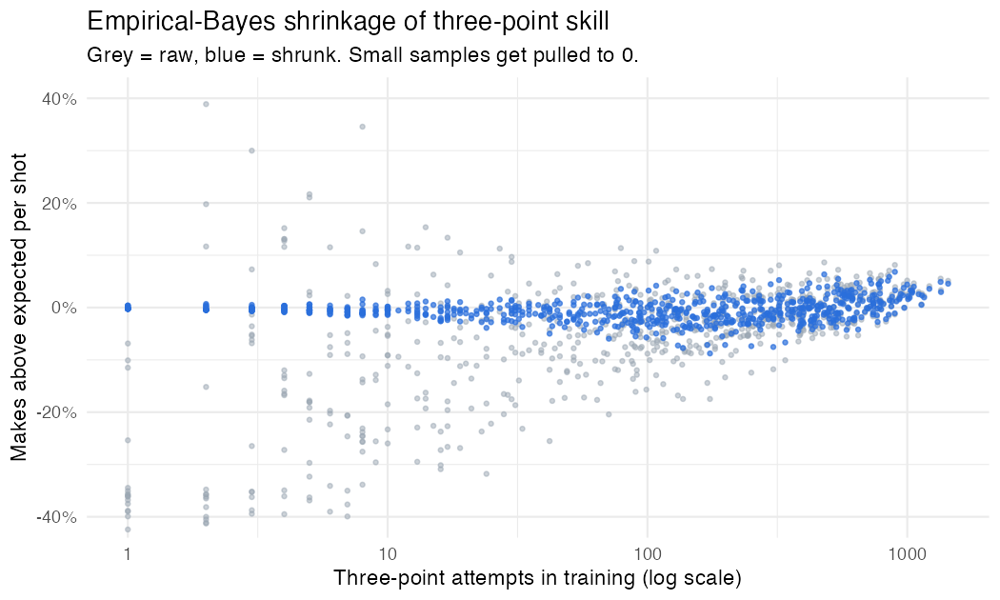
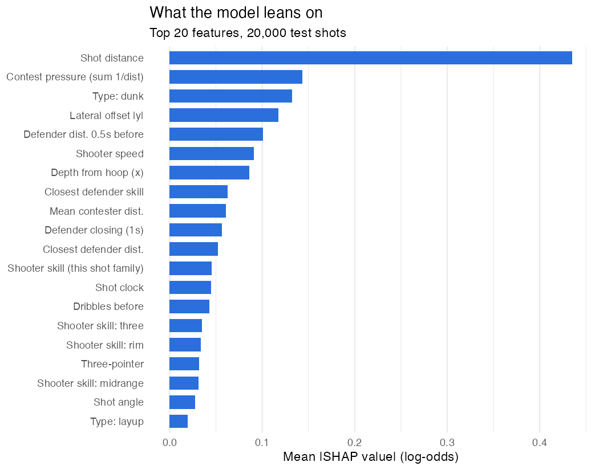
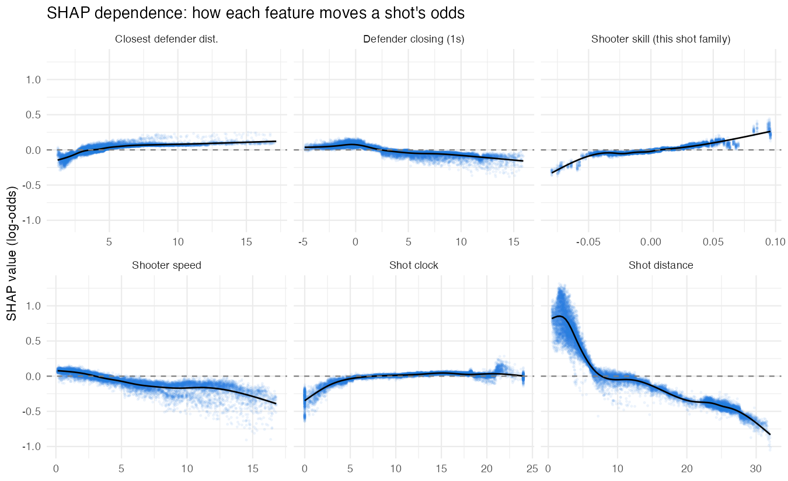
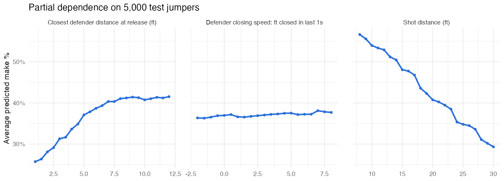
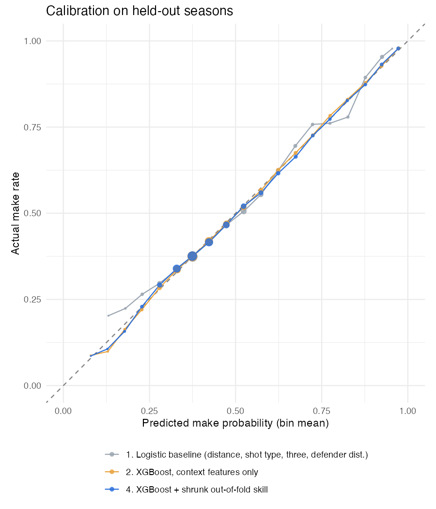

```{r setup, include=FALSE}
# Renders from the outputs of project_code.R; no models are refit here.
knitr::opts_chunk$set(echo = FALSE, message = FALSE, warning = FALSE, fig.align = "center", out.width = "92%")
library(data.table)
m    <- fread("results/model_logloss.csv")
info <- readRDS("results/run_info.rds")
imp  <- fread("results/shap_importance.csv")
pd   <- fread("results/partial_dependence_jumpers.csv")
shk  <- fread("results/shrinkage_k.csv")
ll   <- function(id_) m[id == id_, pooled]
f4   <- function(x) sprintf("%.4f", x)
pct  <- function(x, d = 1) sprintf(paste0("%.", d, "f%%"), 100 * x)
pdv  <- function(feat, v) pd[grepl(feat, feature) & abs(value - v) < 1e-9, make_prob]
final_id <- if (info$USE_CAL == "none") "blend" else info$USE_CAL
```

# Summary

The final model is a **gradient-boosted tree model (XGBoost)**, benchmarked against a logistic regression baseline (a blend of the two was tested; the optimal logistic weight was zero).
Its inputs are shot geometry, defender tracking, shooter context, and an **out-of-fold, empirical-Bayes-shrunk estimate
of each shooter's skill** by shot family. The test file is a season (`r info$test_season`) that is not in either
training season, so every number below comes from **leave-one-season-out validation**: train on one season,
score the other.

```{r headline}
knitr::kable(
  data.table(` ` = c("Always predict league make rate", "Logistic baseline", "Final model"),
             `Held-out log-loss` = f4(c(m$null_model[1], ll("logistic"), ll(final_id)))),
  booktabs = TRUE, align = "lr")
```

# Data and validation design

* **425,719 training shots** from two seasons (`r paste(info$seasons, collapse = ", ")`) and 213,977 test shots from a third.
  Because the test season is new, random k-fold CV would be slightly optimistic: the same games, lineups, and
  season-level shooter form would show up in both train and validation. I hold out a whole season instead,
  and report the pooled log-loss over both held-out seasons.
* About 99% of test shots come from shooters who also appear in training, so historical shooter skill carries over.
* Data checks that shaped features:
  - `distance` equals the Euclidean distance from $(x,y) = (-41.75, 0)$ to within $10^{-10}$, which fixes the hoop and lets me derive angle and corner-three geometry.
  - `shotclock` has no NAs, but values of exactly 0 and exactly 24 appear ~10k times each, which suggests codes for "clock off" or "just reset". I flag both.
  - `closestdefapproach` is a text array `{d_1.0s, d_0.75s, d_0.5s, d_0.25s}`, which I parse into numbers.

# Features

| Group | Features |
|---|---|
| Location | distance, depth from hoop, lateral offset, shot angle, three, corner-three flag, heave flag |
| Shot type / state | one-hot shot type, game state (halfcourt / transition / second chance), month |
| Defense | closest-defender distance at release, # contesters, mean contester distance, contest pressure $\sum 1/d$, defender distance 0.5s before, **closing speed** = distance 1s (and 0.25s) before release minus distance at release |
| Shooter context | shooter speed, dribbles before, shot clock, shot-clock = 0 / = 24 flags, late-clock ($\le$ 4s) flag |
| Player skill | shooter makes-above-expected for rim / midrange / three (plus the one matching this shot), closest-defender makes-allowed-above-expected. (Shooter volume and 3PA rate were tried and dropped; see Section 7.) |

## Shooter skill without leakage

"Expected" is an **out-of-fold context-only XGBoost**, which uses every feature except player identity. For shooter $i$ in shot family $f$:

$$\text{skill}_{if} = \frac{\sum (y - \hat p)}{n_{if} + k_f}, \qquad k_f = \frac{\bar{\sigma}^2_f}{\hat\tau^2_f}$$

$\hat\tau^2_f$ is the true between-shooter variance, estimated by method of moments (observed variance of per-shooter
mean residuals minus the expected binomial noise). A shooter with few attempts is pulled toward 0 (league average given
the shot), and a high-volume shooter keeps most of their residual. Estimated $k$ (the "prior attempts"):
`r paste(sprintf("%s = %.0f", shk$fam, shk$k), collapse = ", ")`. Three-point skill needs the most attempts before it is trusted, consistent with how noisy three-point percentage is.

Leakage control is two-level. Both $\hat p$ and the skill value for a training row are computed from **other folds only**.
Rows being scored (the held-out season, or the test set) get skill computed from all training rows, which is exactly
the situation the real test shots are in.

```{r shrink, fig.cap="Raw vs. shrunk three-point skill. Low-volume shooters' extreme raw values collapse toward 0.", out.width="80%"}

```

# Model progression

```{r progression}
tab <- m[, .(Model = model, `Pooled` = f4(pooled))]
hold_cols <- grep("^holdout_", names(m), value = TRUE)
for (h in hold_cols) tab[, (paste("Hold out", sub("holdout_", "", h))) := f4(m[[h]])]
knitr::kable(tab, booktabs = TRUE, caption = "Held-out log-loss (lower is better). Rows marked x are diagnostic experiments, not candidates.")
```

```{r deltas}
d <- function(a, b) sprintf("%.4f", ll(a) - ll(b))
```

Reading the table top to bottom:

1. **Logistic baseline, `r f4(ll("logistic"))`.** Distance splines, shot type, three, and closest-defender distance already
   capture most of the easy signal (the null model scores `r f4(m$null_model[1])`).
2. **Context XGBoost, `r f4(ll("xgb_context"))`** (`r d("logistic", "xgb_context")` better). This is the biggest single step. The gain comes
   from interactions a linear model can't express. For example, the raw make rate is *not* monotonic in defender distance, because
   wide-open shots are disproportionately long threes, while at a fixed location more space always helps. Trees learn that conditional effect.
3. **+ raw out-of-fold skill, `r f4(ll("xgb_skill_raw"))`.** Real signal, but noisy for low-volume shooters.
4. **+ shrunk skill, `r f4(ll("xgb_skill_shrunk"))`** (a further `r d("xgb_skill_raw", "xgb_skill_shrunk")`). Shrinkage turns shooter identity into a
   stable feature. It improves both held-out seasons.
5. **Blend.** The log-loss-optimal weight on the logistic model was `r sprintf("%.2f", 1 - info$W_BLEND)`: the boosted model
   already contains everything the baseline knows. I kept the logistic model as an interpretable anchor, not as a production component.
6. **Calibration.** Platt and isotonic, each fit on one held-out season and applied to the other, did *not* improve log-loss
   (the calibration plot below shows why), so the final predictions are the uncalibrated XGBoost output.

The two rows marked **x** are experiments that went into the "what didn't work" section.

# What drives the prediction

```{r shap, fig.cap="Mean absolute SHAP value (contribution to log-odds) on 20,000 test shots."}

```

```{r groups}
grp <- function(f) fcase(
  f %in% c("distance","x_from_hoop","abs_y","angle","three","corner3","heave"), "Location",
  grepl("^st_", f), "Shot type",
  f %in% c("closestdefdist","num_contesters","contest_mean","contest_pressure","close_1s","close_025","def_d050"), "Defense (tracking)",
  f %in% c("sk_fam","sk_rim","sk_mid","sk_three"), "Shooter skill",
  f == "def_skill", "Defender skill",
  default = "Shooter context / game state")
g <- imp[, .(share = sum(mean_abs_shap)), by = .(group = grp(feature))][, share := share / sum(share)][order(-share)]
knitr::kable(g[, .(`Feature group` = group, `Share of total |SHAP|` = pct(share))], booktabs = TRUE,
             caption = "SHAP importance summed by feature group.")
```

* **Location dominates.** Shot distance alone is the largest single feature. Every foot matters most near the rim,
  where the curve is steepest (SHAP dependence, bottom right).
* **Defense is the second pillar**, but it is spread across several correlated tracking features: contest pressure,
  the defender's position 0.5s before release, mean contester distance, closing speed, and release distance. Summed as a group it is
  second only to location.
* **Shooter speed** hurts: shots taken while moving fast (off-balance, on the run) go in less often at the same spot.
* **The shot clock** mostly matters at the very end: shots with under ~4 seconds left are clearly worse (forced shots).
* **Shooter skill** is modest per shot on average, but it is what separates a great shooter from a poor one at the same spot.
  Its SHAP dependence is close to linear and monotone, which is the behavior you want from a skill estimate.

```{r shapdep, fig.cap="SHAP dependence: each point is a test shot, the line is a smoother."}

```

## Partial dependence: the basketball logic on jumpers

```{r pdp, fig.cap="Average predicted make probability over 5,000 test jumpers as one input is swept. For distance, each shot slides along its own ray from the hoop, with three-point status and location features recomputed."}

```

```{r pdnums}
pd_d <- function(v) pdv("Shot distance", v)
pd_c <- function(v) pdv("defender distance", v)
pd_s <- function(v) pdv("closing", v)
```

Partial dependence plots are only honest if the swept input moves the way it does on a real court. The tracking features are highly
correlated, so I move them together. Distance slides each shot along its own ray, recomputing three-point status and location. Defender distance
moves the whole defender, including their position 0.5s earlier and their contribution to contest pressure. Closing speed sets a linear
approach path that ends at the real release distance. (A first version swept one column at a time. It produced nearly flat defender curves,
because the model credited the effect to the correlated columns that were held fixed.)

On an average test jumper:

* **Distance:** `r pct(pd_d(10))` at 10 ft, `r pct(pd_d(20))` at 20 ft, `r pct(pd_d(26))` at 26 ft. There is a visible step at the three-point
  line, where shot selection and mechanics change.
* **Space:** a jumper with the closest defender at 2 ft goes in `r pct(pd_c(2))` of the time, versus `r pct(pd_c(6))` at 6 ft,
  a gain of about **`r sprintf("%.1f", 100 * (pd_c(6) - pd_c(2)))` percentage points** for four extra feet.
* **Closing speed:** I expected "a closing defender costs X%". The data says something subtler. *Holding the release distance fixed*, a defender
  who closed 5 ft in the last second changes the make probability by only **`r sprintf("%+.1f", 100 * (pd_s(5) - pd_s(0)))` percentage points** compared with a
  stationary one. That makes sense on a court: if the defender ends at the same spot, a fast closeout means the defender was *farther away* while the shooter
  gathered, so the shooter had more room during the motion. The contest that hurts is the one that is *there at release*. Closing
  speed matters mostly through where the defender ends up, which the release-distance curve already captures. The SHAP dependence
  for closing speed is negative only because it is conditioned on the defender's position 0.5s earlier, which is a different question.

# Calibration

```{r cal, fig.cap="Predicted vs. actual make rate in 5-point bins on the held-out seasons.", out.width="62%"}

```

All three models track the diagonal closely on seasons they never saw. The logistic baseline is the least calibrated at the extremes
(it under-predicts shots it rates at 10–25%, where its linear distance terms can't bend enough for long pull-ups and heaves). Both XGBoost models are within a point or two in every bin with
meaningful volume. That is why cross-fitted Platt and isotonic calibration didn't reduce log-loss: there is no systematic bias left to remove,
and isotonic adds step-function noise.

# What didn't work, and pitfalls

* **My first skill model made predictions *worse*.** With shooter volume and 3PA-rate features included, the skill model scored
  `r f4(ll("xgb_skill_volume"))`, worse than using no skill at all (`r f4(ll("xgb_context"))`). The clue was early stopping: it stopped
  after `r paste(info$best_iters[grepl("volume", names(info$best_iters))], collapse = " / ")` rounds (one per held-out season) versus
  `r paste(info$best_iters[grepl("shrunk", names(info$best_iters))], collapse = " / ")` for the final skill model, a sign of overfitting to something that doesn't transfer. A separate diagnostic (not part of the final script) showed
  the skill signal itself was real: adding cross-season shrunk skill to a frozen context prediction in a logistic regression improved log-loss
  on the other season. The culprit was the **volume features**. Inside training they are counted out-of-fold (on 4/5 of the rows),
  but for the scored season on all rows, so their scale shifts between fit time and prediction time. Dropping them gave `r f4(ll("xgb_skill_shrunk"))`.
  The lesson: out-of-fold features must also have the *same distribution* at fit and predict time, not just no leakage.
* **Raw FG% vs. shrinkage.** Raw out-of-fold makes-above-expected helps less than the shrunk version (`r f4(ll("xgb_skill_raw"))` vs
  `r f4(ll("xgb_skill_shrunk"))`). A shooter who went 3-for-3 from deep looks like the best shooter in the league. Empirical Bayes needs
  ~`r round(shk[fam == "three", k])` three-point attempts before it trusts half of a shooter's residual.
* **Leakage is real, just smaller than I expected.** Computing skill *in-sample* (each shot's own outcome included) scored
  `r f4(ll("xgb_skill_leaky"))`, no better than having no skill feature, and worse than doing it properly. The effect is modest here because each shot
  is weighted by only $1/(n+k)$ with $k \approx 150$+. With smaller $k$ or target-encoded IDs it would be much worse.
* **One-at-a-time partial dependence lied** about defense (see above). Correlated tracking features need coherent perturbations.
* **Random k-fold would have been optimistic.** The test file is an unseen season, so I validated by season. One small optimism remains that
  I want to flag: the number of boosting rounds was chosen by early stopping on the held-out season. The final model uses
  `r info$N_FINAL` rounds (1.15x the mean best iteration, since it trains on twice the data).
* **Shot clock at exactly 0 or 24** behaves like a code, not a measurement (e.g. clock off at the end of a period). I flagged it rather than
  treating it as real time remaining.

# What I would add with more time or data

* **Shooter fatigue / load**: minutes played in the game, time since last rest, back-to-backs. Month is a weak proxy.
* **Catch-and-shoot vs. pull-up, and pass origin**: `dribblesbefore` = 0 approximates catch-and-shoot but not the pass type (skip pass, drive-and-kick) or the time from catch to release.
* **Body mechanics**: shooter body orientation relative to the rim, feet set vs. moving laterally, release height and release time, and defender hand/closeout direction (a hand in the face matters more than distance).
* **Defender identity at scale**: a proper defender-contest model, e.g. a hierarchical model with shooter and defender random effects fit jointly rather than two separate residual passes.
* **Hierarchical skill across families**: borrow strength between a shooter's midrange and three-point skill (a player good at one tends to be good at the other) with a multivariate prior.
* **Time-aware skill**: weight recent shots more, since skill drifts across seasons. The leave-one-season-out results show how much signal survives a season boundary.
* **Tuning**: a small Bayesian hyperparameter search and a monotone constraint on closest-defender distance within shot family.

# Reproducibility

`Rscript project_code.R` (R `r getRversion()`, xgboost, data.table, ggplot2, splines, R.utils) runs everything
and fills `submission.csv`. Seed fixed at 2027. This write-up (`project_writeup.Rmd`) only reads the saved outputs in `results/` and `figures/`.
